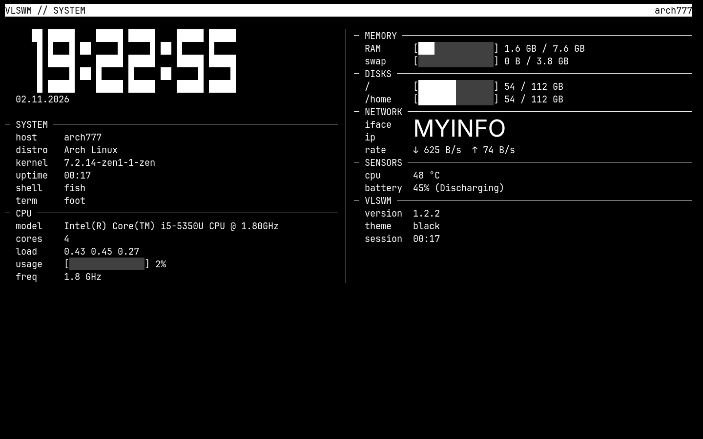
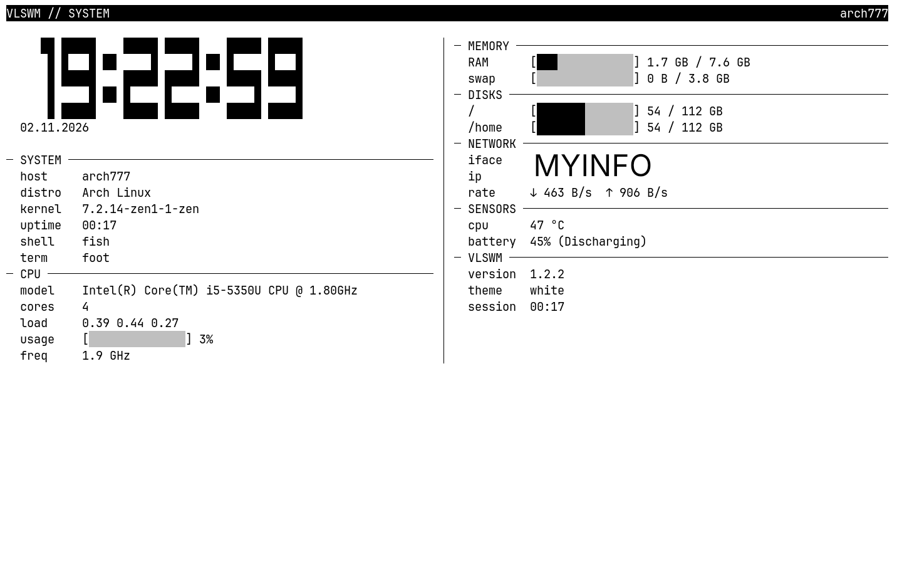
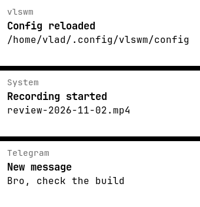
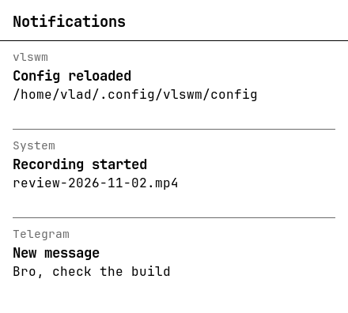
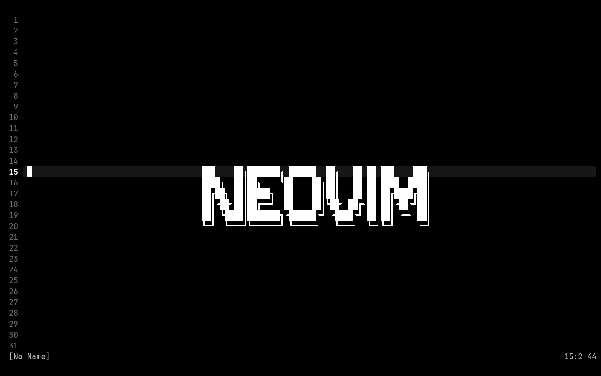
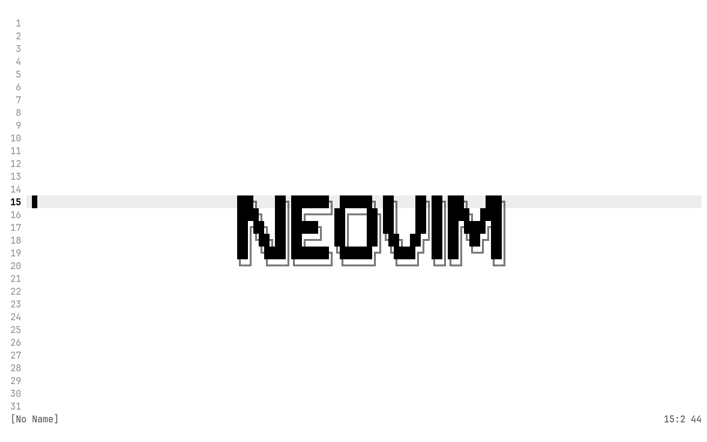
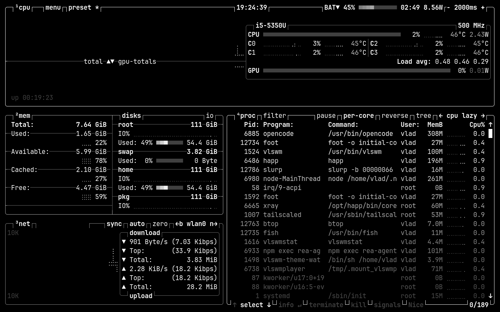
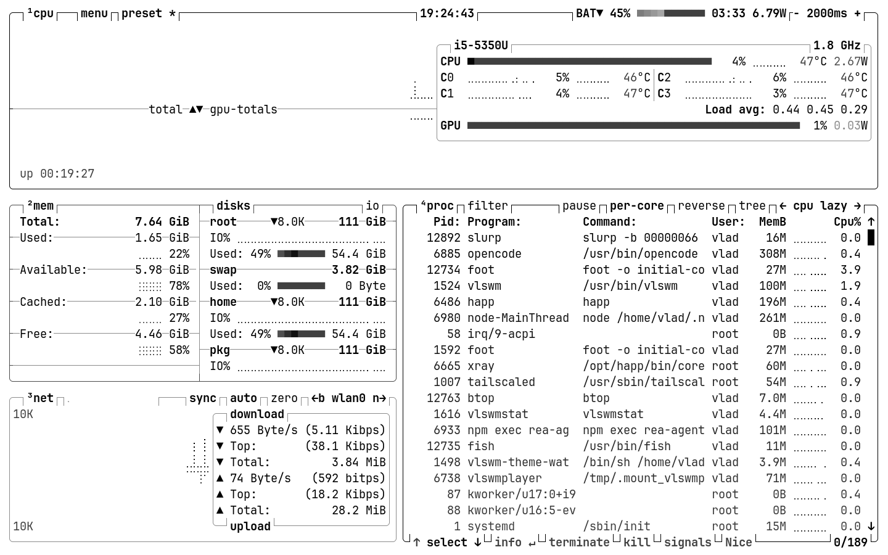
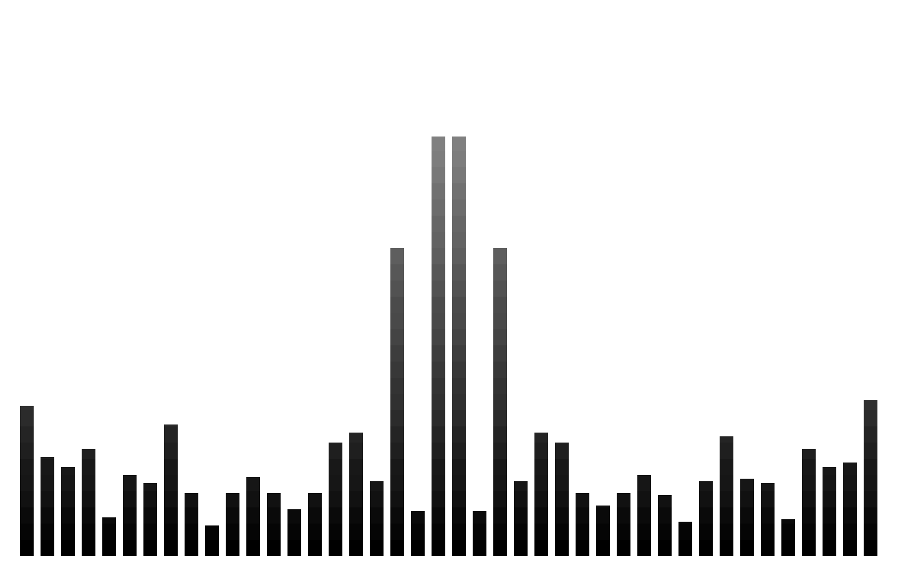

# vlswm

English | [Русский](README.ru.md)

This is my personal Wayland shell on **wlroots 0.20**, for Arch Linux and Arch-based distributions. I built it for the way I work: my desktop is a terminal (foot), apps open on top of it fullscreen, and I use only black and white, square corners and no wallpaper.

**Version 1.2.4.**

> **Supported systems:** Arch Linux and Arch-based distributions only (Manjaro, EndeavourOS, CachyOS, …). Other distributions are not supported.
>
> **This is my personal setup.** I configured everything for myself: the terminal, keybindings, colors, scripts and dotfiles. When you install vlswm, you get the environment I use personally every day. It is not a universal desktop and I do not try to make it one — change the config if something does not fit you.
>
> Experimental project. I wrote it with AI help.

## Screenshots

| Dashboard, black theme | Dashboard, white theme |
|---|---|
|  |  |

| Launcher, black theme | Launcher, white theme |
|---|---|
|  |  |

| Notification cards | Notifications panel |
|---|---|
|  |  |

## Dotfiles (personal environment)

The `dots/` folder is my personal environment, tuned to the way I actually use VLSWM: my Neovim (`dots/nvim`), btop (`dots/btop`) and cava (`dots/cava`) configs, all monochrome and following the VLSWM theme, plus the `vlswm-theme-watch` user service that keeps btop and cava in sync with `SUPER+T`.

`install.sh` asks whether to install them and moves anything it replaces to a timestamped `.backup` directory. This is the environment I use personally (Zen browser, yazi, a full Neovim setup). If you install it, you get my setup, not a universal default.

| Neovim, black theme | Neovim, white theme |
|---|---|
|  |  |

| btop, black theme | btop, white theme |
|---|---|
|  |  |

| cava, black theme | cava, white theme |
|---|---|
|  |  |


## How it works

- When I start vlswm, **foot** opens fullscreen as the base layer: I cannot close it. If it exits (for example `exit` in fish), vlswm starts it again.
- Any app I open appears **on top**, fullscreen. Windows are stacked.
- `SUPER+←` / `SUPER+→` cycles windows.
- `SUPER+Q` closes the focused window. The base foot cannot be closed.
- `SUPER+ENTER` opens a new terminal. The base (first) terminal cannot be closed; new windows are closed with `SUPER+Q`.
- `SUPER+D` opens the launcher: a black (or white) rectangle in the center with an input field. Search only covers `.desktop` files (Name, GenericName, file name), case-insensitive. One best match is shown below the field; `Enter` launches it. If nothing matches, there is no suggestion and `Enter` does nothing. Apps with `Terminal=true` open in a separate foot window. `Esc` cancels.
- `SUPER+T` toggles the theme: black ↔ white. The screen background, launcher frame and input field change. The foot theme changes in **all** terminal windows too: vlswm sends `SIGUSR1` (black) or `SIGUSR2` (white) to every window, without restarting it.
- Window animation: fade + 14 px rise on open and 10 px on close, 200 ms. The launcher appears instantly; `[launcher] duration` sets its delay in ms (0 — no animation).
- X11 apps work through `xwayland-satellite`, started on first use.
- Volume, screen brightness and keyboard backlight changes show a minimal inverted-theme vertical bar at the right edge, vertically centered.

## My browser

I use **zen-browser** and recommend it for vlswm. It behaves predictably in a fullscreen window, and its menus and popups work correctly after the fixes in this release. I bound it to `SUPER+Z` in my default config.

## Apps and colors

`SUPER+T` changes the colors of my compositor, launcher and foot terminal. I do not touch other apps, so they may look off: some interfaces stay dark or light, some use their own palette. If an app looks wrong, I change its own theme.

## Dependencies

- wlroots 0.20
- `wlr-protocols` — protocol headers are generated from its XML at build time
- wayland, xkbcommon, pixman, libinput, cairo, pango, pangocairo, libsystemd (sd-bus)
- Runtime: `foot` (>= 1.28), `fish`, `xwayland-satellite`, `wf-recorder` (recording), `grim`, `slurp`, `wl-clipboard` (screenshots and clipboard), `cliphist` (clipboard history), `brightnessctl` (brightness), `wireplumber` (`wpctl`, volume), `yazi`, `neovim`, `btop`, `cava` (dotfiles)
- Font `JetBrainsMono Nerd Font` (or any other set in `[launcher] font`)
- `zen-browser-bin` (AUR) — my browser; install it manually with `yay`/`paru`
- `mesa` — software OpenGL, needed in virtual machines without 3D acceleration

## Build and install

```bash
cmake -B build
cmake --build build
```

Release with LTO is the default. Binary: `build/vlswm`. Install: `sudo ./install.sh` — it builds Release and installs stripped copies to `/usr/bin`. This installs the same setup I use. For debugging: `cmake -B build -DCMAKE_BUILD_TYPE=RelWithDebInfo`.

CMake generates the missing protocol headers from `wlr-protocols` and creates compatible copies of the wlroots headers where the C99 `[static N]` syntax is replaced with `[N]` — otherwise a C++ compiler on a clean Arch refuses to build the project. If a system protocol XML is missing or empty, the copy from `protocols/` in the repository is used.

Run from a TTY or from an SDDM session named `vlswm`. Another config: `vlswm -c /path/to/config`.

`install.sh` also asks whether to install my personal dotfiles from `dots/` (the Neovim, btop and cava configs I use) and enables the `vlswm-theme-watch` user service so btop and cava follow the VLSWM theme.

### Updating

```bash
sudo vlswm-update
```

The command always installs the latest GitHub release: it looks up the newest tag, clones it into `/opt/vlswm`, builds it and replaces `/usr/bin/vlswm`, `/usr/bin/vlswmstat`, the recording/screenshot scripts and the SDDM session file. It re-clones and reinstalls even when that release is already installed. I never touch your config during an update. Log out and back in to use the new binaries.

## Configuration

File: `~/.config/vlswm/config`. Reload without restarting: `SUPER+R`.

I keep the default config in the repository hardware-agnostic, and it may gain new options over time; check `config/config` on GitHub after updating. Every release lists the new config keys.

Combos are written as `MODIFIERS+KEY`. Modifiers: `SUPER`, `SHIFT`, `CTRL`, `ALT`. One action may have several keys separated by commas.

```ini
[keybinds]
launcher = "SUPER+D"
close = "SUPER+Q"
reload = "SUPER+R"
exit = "SUPER+ESC"
theme = "SUPER+T"
focus_prev = "SUPER+RIGHT"
focus_next = "SUPER+LEFT"
file_manager = "SUPER+E"
terminal = "SUPER+ENTER"
restart_terminal = "SUPER+SHIFT+R"
record = "SUPER+ALT+R"
record_stop = "SUPER+ALT+S"
screenshot = "SUPER+SHIFT+A"
clipboard = "SUPER+SHIFT+V"
notifications = "SUPER+N"
zen = "SUPER+Z"                 # app: a key from [commands]

[commands]
zen = "zen-browser"            # any app: name = command
record = "$HOME/.local/bin/vlswm-record start"
record_stop = "$HOME/.local/bin/vlswm-record stop"
screenshot = "$HOME/.local/bin/vlswm-screenshot"

[launcher]
terminal = "foot"
file_manager = "yazi"
font = "JetBrainsMono Nerd Font 16"
duration = 0                   # ms; 0 = no animation

[theme]
foot = "~/.config/foot"        # foot config directory

[animations]
duration = 200                 # ms

[input]
repeat_delay = 200             # ms before the first repeat
repeat_rate = 40               # repeats per second
scroll_speed = 0.5             # scroll speed multiplier (touchpad and wheel)
layout = "us,ru"               # keyboard layouts
layout_options = "grp:win_space_toggle"   # SUPER+SPACE switches the layout
repeat = "focus_next, focus_prev"

[record]
audio = "mic"                  # mic | system | both

[xwayland]
satellite = "xwayland-satellite"
display = ":1"

[output]
scale = 1.0                   # interface scale (1.0, 1.5, 2.0)
```

### Hardware keys (optional)

The default config does not bind brightness, volume or the microphone: they depend on the machine. Add what you need:

```ini
[keybinds]
brightness_up = "XF86MonBrightnessUp"
brightness_down = "XF86MonBrightnessDown"
volume_up = "XF86AudioRaiseVolume"
volume_down = "XF86AudioLowerVolume"
volume_mute = "XF86AudioMute"
mic_toggle = "SUPER+ALT+M"

[commands]
brightness_up = "brightnessctl -q set 5%+"
brightness_down = "brightnessctl -q set 5%-"
volume_up = "wpctl set-volume @DEFAULT_AUDIO_SINK@ 5%+"
volume_down = "wpctl set-volume @DEFAULT_AUDIO_SINK@ 5%-"
volume_mute = "wpctl set-mute @DEFAULT_AUDIO_SINK@ toggle"
mic_toggle = "$HOME/.local/bin/vlswm-mic"

[input]
repeat = "focus_next, focus_prev, volume_up, volume_down, brightness_up, brightness_down"
```

Keyboard backlight on Macs: add `kbd_brightness_up = "XF86KbdBrightnessUp"` / `kbd_brightness_down = "XF86KbdBrightnessDown"` and commands with `brightnessctl --device='smc::kbd_backlight' set 5%+` / `5%-`.

### Binding an app to a key

1. In `[commands]` set a name and a command: `name = "command"`.
2. In `[keybinds]` set the same name and a key: `name = "SUPER+X"`.

Apps do not repeat while a key is held. Only actions listed in `[input] repeat` repeat.

### Terminal theme (foot)

vlswm reads the base palette from `[colors-dark]` in `~/.config/foot/foot.ini`, writes `vlswm-theme.ini` with the inverted palette in `[colors-light]` and adds an `include=~/…/vlswm-theme.ini` line to `foot.ini`. The base palette is re-read on start and on `SUPER+R`, so the colors in `[colors-dark]` matter. `vlswm-theme.ini` is generated and rewritten on every `SUPER+R`; editing it by hand is pointless.

On `SUPER+T` vlswm sends `SIGUSR1` (black theme) or `SIGUSR2` (white) to every foot window. This switches already open windows without restarting them. New windows start in the current theme via `initial-color-theme`.

foot 1.28 or newer is required: older versions do not know the `[colors-dark]` / `[colors-light]` sections.

## Screen recording

`SUPER+ALT+R` starts recording, `SUPER+ALT+S` stops it. Recording uses `wf-recorder` (VAAPI H.264, 30 fps, audio from `[record] audio`) and falls back to `libx264` when hardware encoding is unavailable. File: `~/Videos/review-*.mp4`. Stopping waits until the file is finalized, so it opens immediately. The audio source is set by `[record] audio`: `mic` (default source), `system` (default sink monitor) or `both` (a temporary null sink mixing both). With `mic`, `SUPER+ALT+M` turns the microphone on (unmute at 100%) or off (mute) at any time, including during a recording. Start and stop are confirmed by a small square at the right edge above the center: filled means recording started, an outline means it stopped.

```bash
wf-recorder -f record.mp4     # whole screen, Ctrl+C to stop
```

I record only the whole screen. Capturing individual windows requires foreign-toplevel, which vlswm does not implement. While recording vlswm disables direct scanout and composites every frame.

## Taking screenshots

`SUPER+SHIFT+A` — select a region (slurp), save a PNG (grim) and copy it to the clipboard (wl-copy). File: `~/Downloads/YYYY-MM-DD-HHMMSS.png`. `Esc` cancels.

## Notifications

vlswm is my notification daemon: it owns `org.freedesktop.Notifications`, so notifications from any app (Telegram, mail, scripts) appear on the left, vertically centered, as inverted-theme cards. Up to 3 cards are shown, each for 4 seconds. `SUPER+N` opens the panel with the last 50 notifications; `Esc` closes it, `C` clears the history. Recording start/stop and config reloads also post notifications.

Only one notification daemon can own the name: stop `mako`, `dunst` or another daemon if one is running.

## Clipboard history

`SUPER+SHIFT+V` opens a vertical panel in the center: typing filters entries, `↑`/`↓` selects, `Enter` puts the entry into the clipboard, `Esc` closes. History is kept by `cliphist`.

At session start vlswm runs `wl-paste --watch cliphist store`, so copying in any app lands in the history. `cliphist` and `wl-clipboard` are required.

## vlswmstat

`vlswmstat` is my compact monochrome dashboard: hostname, distro, kernel, system age, uptime, shell, terminal, CPU, memory, disks, network, sensors, battery and VLSWM data. The large clock and date update every second. System age comes from the root filesystem birth time; if the filesystem does not support it, the first line of `/var/log/pacman.log` is used.

```bash
vlswmstat           # live dashboard, quit with q or Esc
vlswmstat --once    # one frame and exit
vlswmstat --version
```

Keys: `q` / `Esc` — quit, `r` — refresh, window resizes are picked up automatically.

`install.sh` adds `~/.config/fish/conf.d/vlswmstat.fish`, so the dashboard is shown as a greeting when the base terminal starts. New terminals (`SUPER+ENTER`) have no greeting. To disable it, comment out the `vlswmstat` line in that file.

## My default keybindings

| Keys | Action |
|---|---|
| `SUPER+D` | launcher |
| `SUPER+ENTER` | new terminal |
| `SUPER+Q` | close the focused window |
| `SUPER+←` / `SUPER+→` | cycle windows |
| `SUPER+T` | black / white theme |
| `SUPER+SPACE` | switch layout (us / ru) |
| `SUPER+E` | file manager (yazi in a separate foot window) |
| `SUPER+Z` | zen-browser |
| `SUPER+ALT+R` | start screen recording |
| `SUPER+ALT+S` | stop screen recording |
| `SUPER+ALT+M` | microphone on / off |
| `SUPER+SHIFT+A` | screenshot of a selected region |
| `SUPER+SHIFT+V` | clipboard history |
| `SUPER+N` | notifications panel |
| `SUPER+SHIFT+R` | restart the base terminal (reset to fish) |
| `SUPER+R` | reload the config |
| `SUPER+ESC` | exit |
| `SUPER+F1` / `SUPER+F2` | brightness −/+ |
| `SUPER+F3` / `SUPER+F4` | volume −/+ |

## Structure

- `src/main.cpp` — startup, log, arguments.
- `src/server.cpp` — input, bindings, window stack, processes, xwayland-satellite.
- `src/view.cpp` — windows (xdg), open and close.
- `src/launcher.cpp` — launcher (cairo + pango).
- `src/osd.cpp` — volume and brightness overlay.
- `src/clipboard.cpp` — clipboard history picker.
- `src/notify.cpp` — notification daemon, cards and panel.
- `src/rec.cpp` — recording start/stop indicator.
- `src/overlay.cpp` — shared buffer for the launcher, OSD and picker.
- `src/theme.cpp` — foot theme.
- `src/vlswmstat.cpp` — the `vlswmstat` dashboard.
- `src/output.cpp`, `src/ini.cpp`, `src/animation.cpp` — output, config, animations.
- `scripts/vlswm-record` — screen recording via wf-recorder.
- `scripts/vlswm-screenshot` — region selection and screenshot.
- `scripts/vlswm-mic` — microphone toggle for recording.
- `vlswm-update` — installs the latest release.
- `dots/` — my personal Neovim, btop and cava configs and the theme watcher.

## Battery

On my laptop TLP sets `CPU_SCALING_GOVERNOR_ON_BAT=powersave` on battery. With the `intel_cpufreq` driver (intel_pstate in passive mode, as on older Intel CPUs) that governor keeps the minimum frequency even under full load: 800 MHz instead of 2.9 GHz turbo. The whole system becomes 3–4 times slower and apps take much longer to start.

For my interactive work I need `schedutil` and turbo enabled. In `/etc/tlp.conf` I set:

```ini
CPU_SCALING_GOVERNOR_ON_BAT=schedutil
CPU_BOOST_ON_BAT=1
```

TLP reads `/etc/tlp.conf` last, so values in `/etc/tlp.d/*.conf` will not override these lines. I apply it with `sudo tlp start`. At idle schedutil still drops to the minimum frequency, so idle power draw does not grow.

## License

See the `LICENSE` file.
