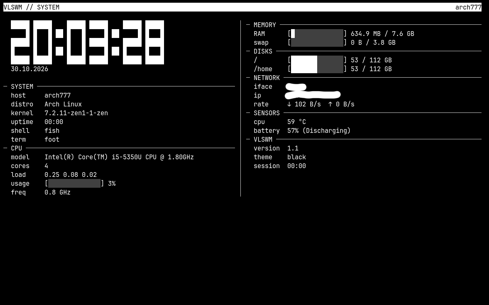
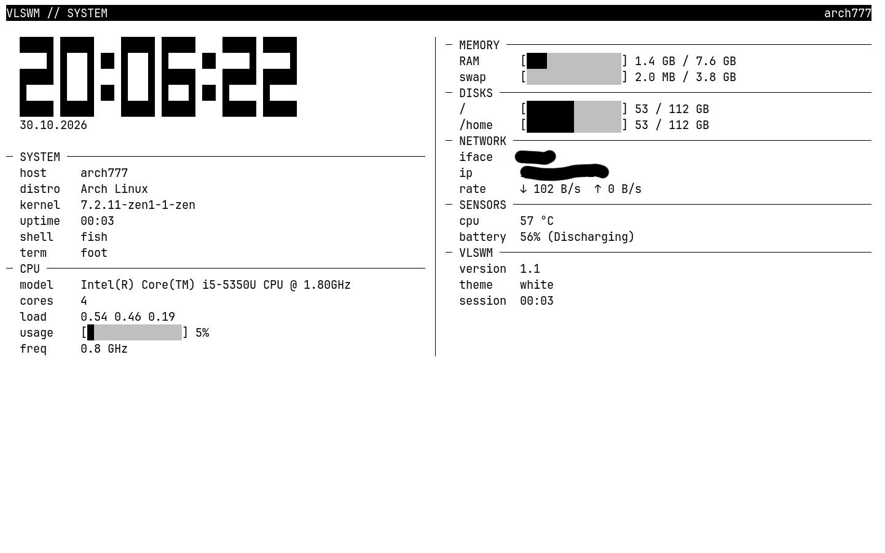
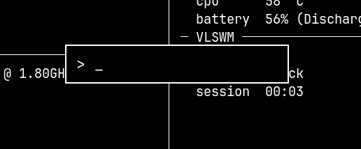
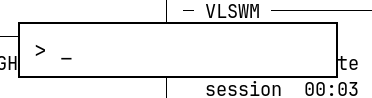
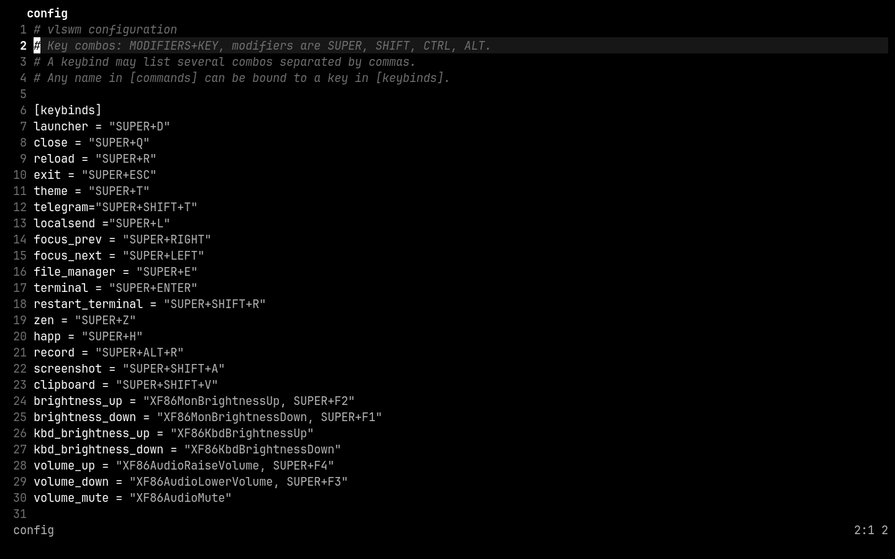

# vlswm

English | [Русский](README.ru.md)

A minimal Wayland shell on **wlroots 0.20** for Arch Linux and Arch-based distributions. The desktop is a terminal (foot); apps open on top of it, fullscreen. Only black and white, only square corners, no wallpaper.

**Version 1.1.**

> **Supported systems:** Arch Linux and Arch-based distributions only (Manjaro, EndeavourOS, CachyOS, …). Other distributions are not supported.

> Experimental project. Written with the help of AI.

## Screenshots

| Dashboard, black theme | Dashboard, white theme |
|---|---|
|  |  |

| Launcher, black theme | Launcher, white theme |
|---|---|
|  |  |



## How it works

- On start **foot** opens fullscreen as the base layer: it cannot be closed. If it exits (for example `exit` in fish), vlswm starts it again.
- Any app opens **on top**, fullscreen. Windows are stacked.
- `SUPER+←` / `SUPER+→` cycles windows.
- `SUPER+Q` closes the focused window. The base foot cannot be closed.
- `SUPER+ENTER` opens a new terminal. The base (first) terminal cannot be closed; new windows are closed with `SUPER+Q`.
- `SUPER+D` opens the launcher: a black (or white) rectangle in the center with an input field. Search only covers `.desktop` files (Name, GenericName, file name), case-insensitive. One best match is shown below the field; `Enter` launches it. If nothing matches, there is no suggestion and `Enter` does nothing. Apps with `Terminal=true` open in a separate foot window. `Esc` cancels.
- `SUPER+T` toggles the theme: black ↔ white. The screen background, launcher frame and input field change. The foot theme changes in **all** terminal windows too: vlswm sends `SIGUSR1` (black) or `SIGUSR2` (white) to every window, without restarting it.
- Window animation: fade + 14 px rise on open and 10 px on close, 200 ms. The launcher appears instantly; `[launcher] duration` sets its delay in ms (0 — no animation).
- X11 apps work through `xwayland-satellite`, started on first use.
- Volume, screen brightness and keyboard backlight changes show a minimal inverted-theme bar at the top of the screen.

## Recommended browser

**zen-browser** is recommended for vlswm. It behaves predictably in a fullscreen window, and its menus and popups work correctly after the fixes in this release. It is bound to `SUPER+Z` in the default config.

## Apps and colors

`SUPER+T` changes the colors of the compositor, the launcher and the foot terminal. The compositor does not touch other apps, so they may look off: some interfaces stay dark or light, some use their own palette. If an app looks wrong, change its own theme.

## Dependencies

- wlroots 0.20
- `wlr-protocols` — protocol headers are generated from its XML at build time
- wayland, xkbcommon, pixman, libinput, cairo, pango, pangocairo
- Runtime: `foot` (>= 1.28), `fish`, `xwayland-satellite`, `wf-recorder` (recording), `grim`, `slurp`, `wl-clipboard` (screenshots and clipboard), `cliphist` (clipboard history), `brightnessctl` (brightness), `wireplumber` (`wpctl`, volume)
- Font `JetBrainsMono Nerd Font` (or any other set in `[launcher] font`)
- `mesa` — software OpenGL, needed in virtual machines without 3D acceleration

## Build and install

```bash
cmake -B build
cmake --build build
```

Release with LTO is the default. Binary: `build/vlswm`. Install: `sudo ./install.sh` — it builds Release and installs stripped copies to `/usr/bin`. For debugging: `cmake -B build -DCMAKE_BUILD_TYPE=RelWithDebInfo`.

CMake generates the missing protocol headers from `wlr-protocols` and creates compatible copies of the wlroots headers where the C99 `[static N]` syntax is replaced with `[N]` — otherwise a C++ compiler on a clean Arch refuses to build the project. If a system protocol XML is missing or empty, the copy from `protocols/` in the repository is used.

Run from a TTY or from an SDDM session named `vlswm`. Another config: `vlswm -c /path/to/config`.

### Updating

```bash
sudo vlswm-update
```

The command always installs the latest GitHub release: it looks up the newest tag, clones it into `/opt/vlswm`, builds it and replaces `/usr/bin/vlswm`, `/usr/bin/vlswmstat`, the recording/screenshot scripts and the SDDM session file. It re-clones and reinstalls even when that release is already installed. Your config is left untouched. Log out and back in to use the new binaries.

## Configuration

File: `~/.config/vlswm/config`. Reload without restarting: `SUPER+R`.

Combos are written as `MODIFIERS+KEY`. Modifiers: `SUPER`, `SHIFT`, `CTRL`, `ALT`. One action may have several keys separated by commas.

```ini
[keybinds]
launcher = "SUPER+D"
close = "SUPER+Q"
reload = "SUPER+R"
exit = "SUPER+ESC"
theme = "SUPER+T"
focus_prev = "SUPER+RIGHT"
focus_next = "SUPER+LEFT"
file_manager = "SUPER+E"
restart_terminal = "SUPER+SHIFT+R"
clipboard = "SUPER+SHIFT+V"
zen = "SUPER+Z"                 # app: a key from [commands]
volume_up = "XF86AudioRaiseVolume, SUPER+F4"

[commands]
zen = "zen-browser"            # any app: name = command
volume_up = "wpctl set-volume @DEFAULT_AUDIO_SINK@ 5%+"

[launcher]
terminal = "foot"
file_manager = "yazi"
font = "JetBrainsMono Nerd Font 16"
duration = 0                   # ms; 0 = no animation

[theme]
foot = "~/.config/foot"        # foot config directory

[animations]
duration = 200                 # ms

[input]
repeat_delay = 200             # ms before the first repeat
repeat_rate = 40               # repeats per second
scroll_speed = 0.5             # scroll speed multiplier (touchpad and wheel)
layout = "us,ru"               # keyboard layouts
layout_options = "grp:win_space_toggle"   # SUPER+SPACE switches the layout
repeat = "focus_next, focus_prev, volume_up, volume_down, brightness_up, brightness_down, kbd_brightness_up, kbd_brightness_down"

[xwayland]
satellite = "xwayland-satellite"
display = ":1"

[output]
scale = 1.0                   # interface scale (1.0, 1.5, 2.0)
```

### Binding an app to a key

1. In `[commands]` set a name and a command: `name = "command"`.
2. In `[keybinds]` set the same name and a key: `name = "SUPER+X"`.

Apps do not repeat while a key is held. Only actions listed in `[input] repeat` repeat.

### Terminal theme (foot)

vlswm reads the base palette from `[colors-dark]` in `~/.config/foot/foot.ini`, writes `vlswm-theme.ini` with the inverted palette in `[colors-light]` and adds an `include=~/…/vlswm-theme.ini` line to `foot.ini`. The base palette is re-read on start and on `SUPER+R`, so the colors in `[colors-dark]` matter. `vlswm-theme.ini` is generated and rewritten on every `SUPER+R`; editing it by hand is pointless.

On `SUPER+T` vlswm sends `SIGUSR1` (black theme) or `SIGUSR2` (white) to every foot window. This switches already open windows without restarting them. New windows start in the current theme via `initial-color-theme`.

foot 1.28 or newer is required: older versions do not know the `[colors-dark]` / `[colors-light]` sections.

## Screen recording

`SUPER+ALT+R` starts and stops recording with `wf-recorder` (VAAPI H.264, 30 fps, default audio). File: `~/Videos/review-*.mp4`.

```bash
wf-recorder -f record.mp4     # whole screen, Ctrl+C to stop
```

Only the whole screen is recorded. Capturing individual windows requires foreign-toplevel, which vlswm does not implement. While recording vlswm disables direct scanout and composites every frame.

## Taking screenshots

`SUPER+SHIFT+A` — select a region (slurp), save a PNG (grim) and copy it to the clipboard (wl-copy). File: `~/Downloads/YYYY-MM-DD-HHMMSS.png`. `Esc` cancels.

## Clipboard history

`SUPER+SHIFT+V` opens a vertical panel in the center: typing filters entries, `↑`/`↓` selects, `Enter` puts the entry into the clipboard, `Esc` closes. History is kept by `cliphist`.

At session start vlswm runs `wl-paste --watch cliphist store`, so copying in any app lands in the history. `cliphist` and `wl-clipboard` are required.

## vlswmstat

`vlswmstat` is a compact monochrome dashboard: hostname, distro, kernel, uptime, shell, terminal, CPU, memory, disks, network, sensors, battery and VLSWM data. The large clock and date update every second.

```bash
vlswmstat           # live dashboard, quit with q or Esc
vlswmstat --once    # one frame and exit
vlswmstat --version
```

Keys: `q` / `Esc` — quit, `r` — refresh, window resizes are picked up automatically.

`install.sh` adds `~/.config/fish/conf.d/vlswmstat.fish`, so the dashboard is shown as a greeting when the base terminal starts. New terminals (`SUPER+ENTER`) have no greeting. To disable it, comment out the `vlswmstat` line in that file.

## Default keybindings

| Keys | Action |
|---|---|
| `SUPER+D` | launcher |
| `SUPER+ENTER` | new terminal |
| `SUPER+Q` | close the focused window |
| `SUPER+←` / `SUPER+→` | cycle windows |
| `SUPER+T` | black / white theme |
| `SUPER+SPACE` | switch layout (us / ru) |
| `SUPER+E` | file manager (yazi in a separate foot window) |
| `SUPER+Z` | zen-browser |
| `SUPER+ALT+R` | start / stop screen recording |
| `SUPER+SHIFT+A` | screenshot of a selected region |
| `SUPER+SHIFT+V` | clipboard history |
| `SUPER+SHIFT+R` | restart the base terminal (reset to fish) |
| `SUPER+R` | reload the config |
| `SUPER+ESC` | exit |
| `SUPER+F1` / `SUPER+F2` | brightness −/+ |
| `SUPER+F3` / `SUPER+F4` | volume −/+ |

## Structure

- `src/main.cpp` — startup, log, arguments.
- `src/server.cpp` — input, bindings, window stack, processes, xwayland-satellite.
- `src/view.cpp` — windows (xdg), open and close.
- `src/launcher.cpp` — launcher (cairo + pango).
- `src/osd.cpp` — volume and brightness overlay.
- `src/clipboard.cpp` — clipboard history picker.
- `src/overlay.cpp` — shared buffer for the launcher, OSD and picker.
- `src/theme.cpp` — foot theme.
- `src/vlswmstat.cpp` — the `vlswmstat` dashboard.
- `src/output.cpp`, `src/ini.cpp`, `src/animation.cpp` — output, config, animations.
- `scripts/vlswm-record` — screen recording via wf-recorder.
- `scripts/vlswm-screenshot` — region selection and screenshot.
- `vlswm-update` — installs the latest release.

## Battery

On laptops TLP sets `CPU_SCALING_GOVERNOR_ON_BAT=powersave` on battery. With the `intel_cpufreq` driver (intel_pstate in passive mode, as on older Intel CPUs) that governor keeps the minimum frequency even under full load: 800 MHz instead of 2.9 GHz turbo. The whole system becomes 3–4 times slower and apps take much longer to start.

Interactive work needs `schedutil` and turbo enabled. In `/etc/tlp.conf`:

```ini
CPU_SCALING_GOVERNOR_ON_BAT=schedutil
CPU_BOOST_ON_BAT=1
```

TLP reads `/etc/tlp.conf` last, so values in `/etc/tlp.d/*.conf` will not override these lines. Apply with `sudo tlp start`. At idle schedutil still drops to the minimum frequency, so idle power draw does not grow.

## License

See the `LICENSE` file.
