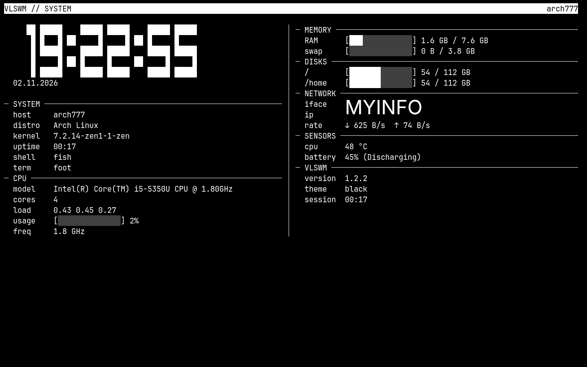
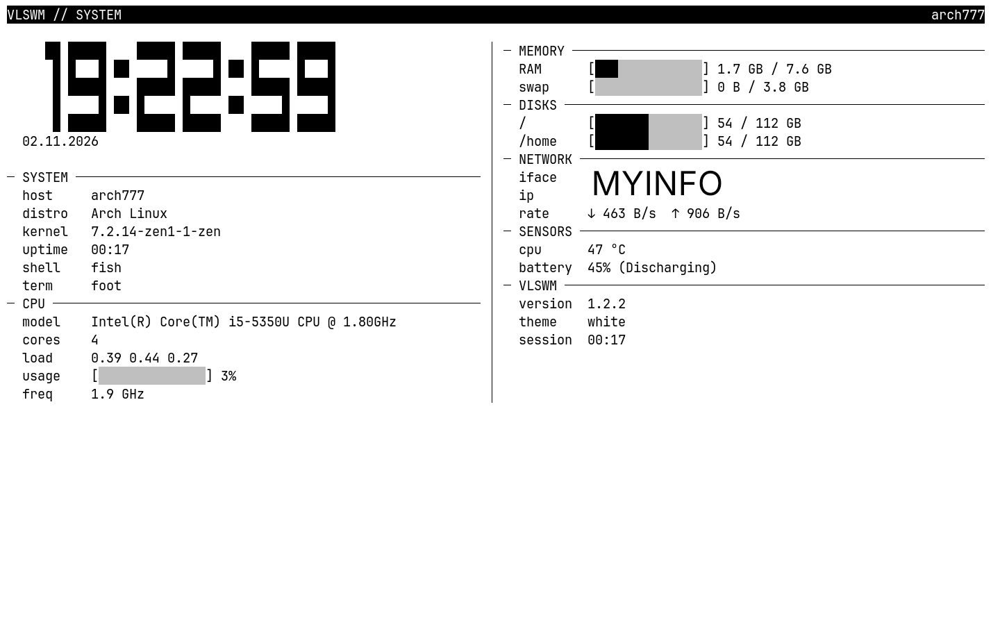
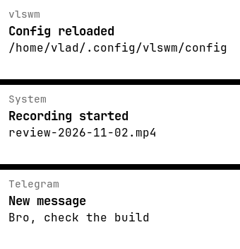
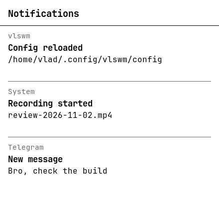
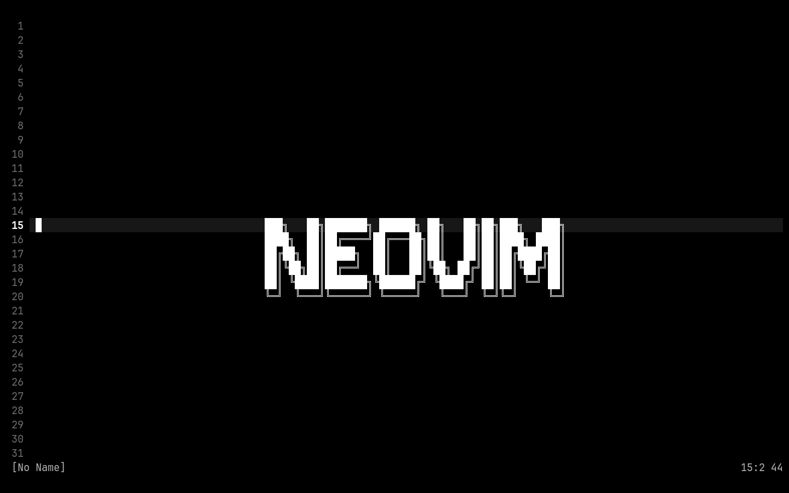
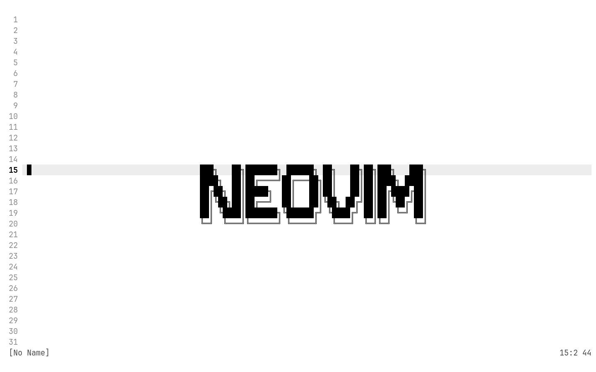
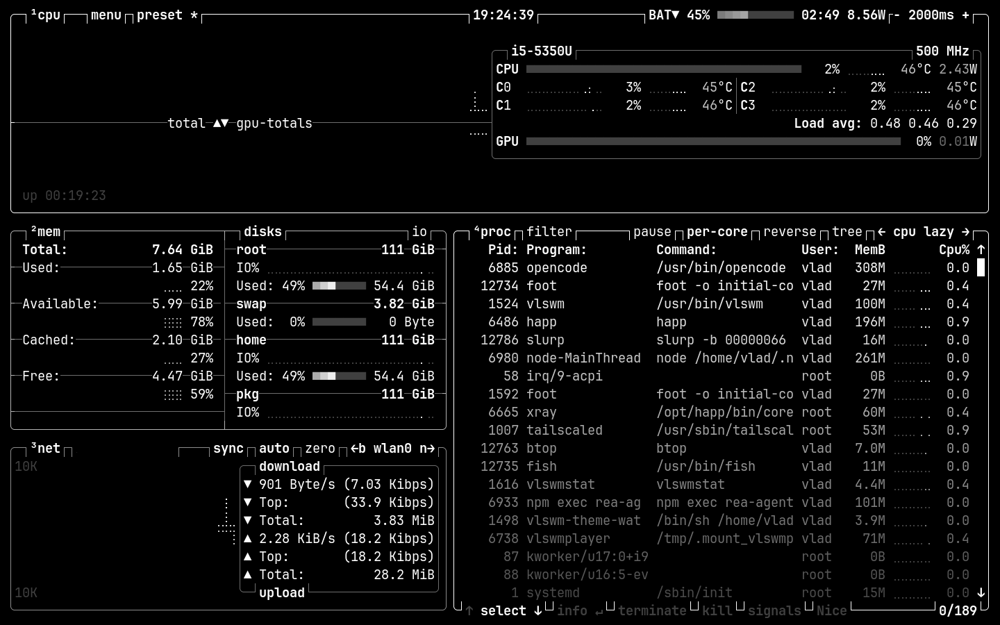
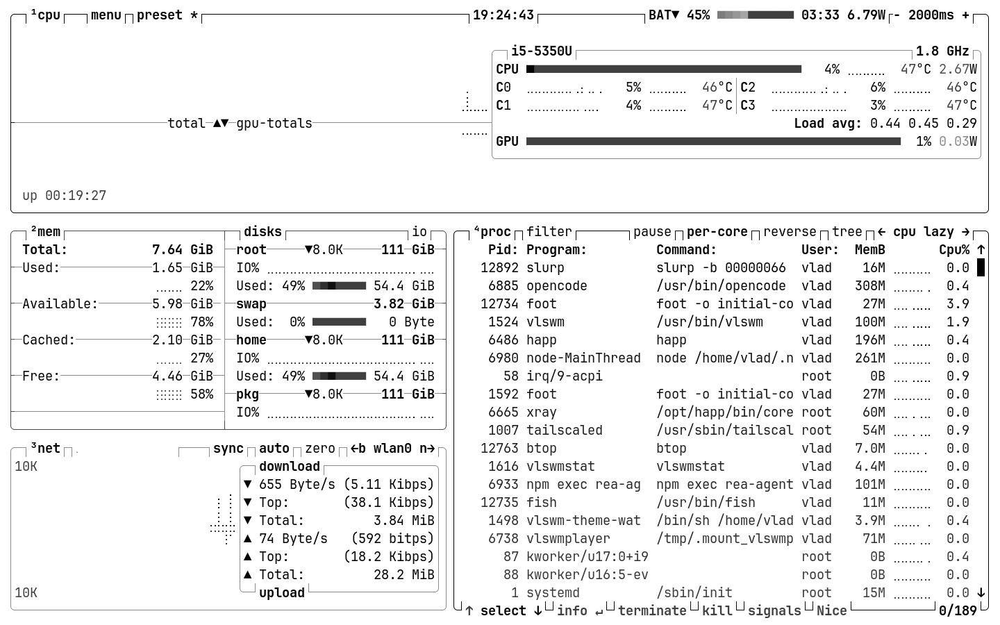
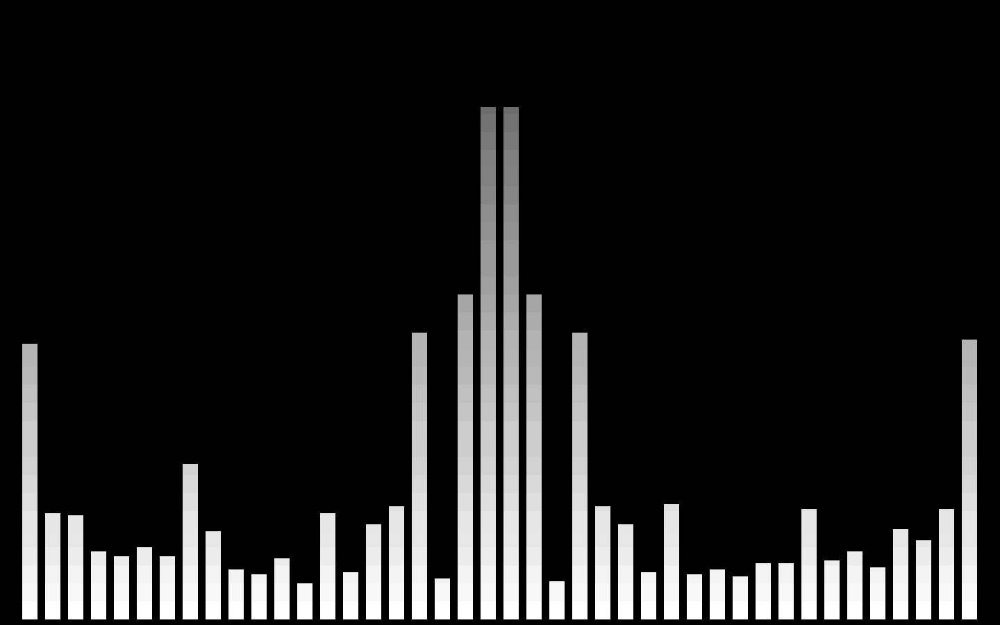
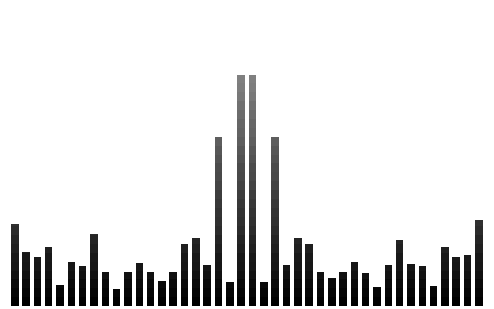

# vlswm

[English](README.md) | Русский

Это моя личная Wayland-оболочка на **wlroots 0.20** для Arch Linux и Arch-based дистрибутивов. Я собрал её под то, как работаю сам: рабочий стол — это терминал (foot), приложения открываются поверх него на весь экран, и я использую только чёрный и белый, прямые углы и никаких обоев.

**Версия 1.2.10.**

> **Поддерживаемые системы:** только Arch Linux и Arch-based дистрибутивы (Manjaro, EndeavourOS, CachyOS и т.п.). Другие дистрибутивы не поддерживаются.
>
> **Это моя личная настройка.** Я всё настроил под себя: терминал, клавиши, цвета, скрипты и dotfiles. Когда ты устанавливаешь vlswm, ты получаешь окружение, которым я сам пользуюсь каждый день. Это не универсальный рабочий стол, и я не пытаюсь его таким сделать — меняй конфиг, если что-то тебе не подходит.
>
> Экспериментальный проект. Я писал его с помощью ИИ.

## Скриншоты

| Дашборд, чёрная тема | Дашборд, белая тема |
|---|---|
|  |  |

| Лаунчер, чёрная тема | Лаунчер, белая тема |
|---|---|
|  |  |

| Карточки уведомлений | Панель уведомлений |
|---|---|
|  |  |

## Dotfiles (личное окружение)

Папка `dots/` — моё личное окружение, настроенное под то, как я реально пользуюсь VLSWM: мои конфиги Neovim (`dots/nvim`), btop (`dots/btop`) и cava (`dots/cava`), всё монохромное и следует теме VLSWM, плюс user-сервис `vlswm-theme-watch`, который держит btop и cava в синхроне с `SUPER+T`.

`install.sh` спрашивает, ставить ли их, и всё заменённое переносит в каталог `.backup` с датой. Это окружение, которым пользуюсь лично я (Zen, yazi, полноценный Neovim). Если ты его ставишь, ты получаешь мою настройку, а не универсальный дефолт.

| Neovim, чёрная тема | Neovim, белая тема |
|---|---|
|  |  |

| btop, чёрная тема | btop, белая тема |
|---|---|
|  |  |

| cava, чёрная тема | cava, белая тема |
|---|---|
|  |  |


## Как это работает

- Когда я запускаю vlswm, сразу открывается **foot** на весь экран. Это базовый слой: закрыть его нельзя. Если он завершился (например, `exit` в fish), vlswm запускает его снова.
- Любое приложение, которое я открываю, появляется **поверх** на весь экран. Окна лежат стопкой.
- `SUPER+←` / `SUPER+→` переключает окна по кругу.
- `SUPER+Q` закрывает сфокусированное окно. Базовый foot не закрывается.
- `SUPER+ENTER` открывает новый терминал. Базовый (первый) терминал закрыть нельзя, новые окна закрываются через `SUPER+Q`.
- `SUPER+D` открывает лаунчер: белый (или чёрный) прямоугольник по центру с полем ввода. Поиск идёт только по `.desktop`-файлам (имя, GenericName, имя файла), без учёта регистра. Под полем показывается одно лучшее совпадение; `Enter` запускает его. Если совпадения нет — подсказки нет и `Enter` ничего не делает. Приложения с `Terminal=true` откроются в отдельном окне foot. `Esc` отменяет.
- `SUPER+T` переключает тему: чёрный ↔ белый. Меняются фон экрана, рамка и поле лаунчера. Тема foot тоже меняется во **всех** окнах терминала: vlswm посылает каждому окну `SIGUSR1` (чёрная) или `SIGUSR2` (белая), без закрытия.
- Анимация окон: fade + подъём на 14 px при открытии и 10 px при закрытии, 200 мс. Лаунчер появляется мгновенно; `[launcher] duration` задаёт задержку в мс (0 — без анимации).
- X11-приложения работают через `xwayland-satellite`, который запускается при первом обращении.
- Drag-and-drop работает для перетаскивания указателем: вкладки, файлы и другие источники. Иконка перетаскивания следует за курсором. Во время drag `SUPER+←` / `SUPER+→` поднимают следующее окно, чтобы можно было бросить файл в другое fullscreen-приложение.
- Изменение громкости, яркости экрана и подсветки клавиатуры показывает минималистичную вертикальную полоску в цветах инверсной темы у правого края по центру.

## Мой браузер

Для vlswm я использую и рекомендую **zen-browser**. Он ведёт себя предсказуемо в окне на весь экран, а меню и popup-окна корректно работают после исправлений этого релиза. В моём дефолтном конфиге он стоит на `SUPER+Z`.

## Приложения и цвета

Переключение темы `SUPER+T` меняет цвета моего композитора, лаунчера и терминала foot. Другие приложения я не трогаю, поэтому они могут выглядеть неправильно: часть интерфейсов остаётся тёмной или светлой, часть использует собственную палитру. Если приложение выглядит некорректно, я меняю его собственную тему.

## Зависимости

- wlroots 0.20
- `wlr-protocols` — из его XML при сборке генерируются заголовки протоколов
- wayland, xkbcommon, pixman, libinput, cairo, pango, pangocairo, libsystemd (sd-bus)
- Рантайм: `foot` (>= 1.28), `fish`, `xwayland-satellite`, `wf-recorder` (запись), `grim`, `slurp`, `wl-clipboard` (скриншоты и буфер), `cliphist` (история буфера), `brightnessctl` (яркость), `wireplumber` (`wpctl`, громкость), `yazi`, `neovim`, `btop`, `cava` (dotfiles)
- `xdg-desktop-portal`, `xdg-desktop-portal-gtk` — выбор файлов в GTK-приложениях
- `xdg-desktop-portal-termfilechooser` (AUR) — открывает `yazi` в диалоге выбора файлов; без него используется GTK-диалог
- Шрифт `JetBrainsMono Nerd Font` (или любой другой, указанный в `[launcher] font`)
- `zen-browser-bin` (AUR) — мой браузер; ставится вручную через `yay`/`paru`
- `mesa` — программный OpenGL, нужен в виртуальных машинах без 3D-ускорения

## Сборка и установка

```bash
cmake -B build
cmake --build build
```

По умолчанию собирается **Release** с LTO. Бинарник: `build/vlswm`. Установка: `sudo ./install.sh` — скрипт собирает Release и кладёт в `/usr/bin` stripped-копии. Ставится та же настройка, которой пользуюсь я. Для отладки: `cmake -B build -DCMAKE_BUILD_TYPE=RelWithDebInfo`.

Headless smoke-тест: `./scripts/vlswm-smoke-test` запускает vlswm с headless-бэкендом, снимает кадр 1280×720 через `grim` и проверяет чистое завершение.

CMake сам генерирует недостающие заголовки протоколов из `wlr-protocols` и создаёт совместимые копии заголовков wlroots, в которых C99-синтаксис `[static N]` заменён на `[N]` — иначе C++-компилятор на чистом Arch отказывается собирать проект. Если системный XML протокола отсутствует или пуст, используется копия из `protocols/` в репозитории.

Запуск из TTY или из SDDM-сессии `vlswm`. Другой конфиг: `vlswm -c /путь/к/config`.

`install.sh` также спрашивает, ставить ли мои личные dotfiles из `dots/` (конфиги Neovim, btop и cava, которыми пользуюсь я), и включает user-сервис `vlswm-theme-watch`, чтобы btop и cava следовали теме VLSWM.

### Обновление

```bash
sudo vlswm-update
```

Команда всегда ставит последний релиз с GitHub: находит самый свежий тег, клонирует его в `/opt/vlswm`, собирает и заменяет `/usr/bin/vlswm`, `/usr/bin/vlswmstat`, скрипты записи/скриншотов и session-файл SDDM. Ещё она обновляет системные env-конфиги (`environment.d`, fish conf и portal-конфиги выбора файлов) с бэкапом по времени; `~/.config/vlswm/config`, `foot.ini` и `dots/` не трогаются. Клон и переустановка выполняются даже если этот релиз уже стоит. Существующие значения конфига никогда не перезаписываются: если в релизе появились новые опции, они дописываются в конец конфига, а старый файл сохраняется как `config.backup.YYYY-MM-DD-HHMMSS`. После обновления перезайди.

## Конфигурация

Файл: `~/.config/vlswm/config`. Перечитать без перезапуска: `SUPER+R`.

Я держу дефолтный конфиг в репозитории без привязки к железу, и он может со временем получать новые опции — после обновления сверься с `config/config` на GitHub. В каждом релизе я перечисляю новые ключи конфига.

Комбинации записываются как `МОДИФИКАТОРЫ+КЛАВИША`. Модификаторы: `SUPER`, `SHIFT`, `CTRL`, `ALT`. Одно действие может иметь несколько клавиш через запятую.

```ini
[keybinds]
launcher = "SUPER+D"
close = "SUPER+Q"
reload = "SUPER+R"
exit = "SUPER+ESC"
theme = "SUPER+T"
focus_prev = "SUPER+RIGHT"
focus_next = "SUPER+LEFT"
file_manager = "SUPER+E"
terminal = "SUPER+ENTER"
restart_terminal = "SUPER+SHIFT+R"
record = "SUPER+ALT+R"
record_stop = "SUPER+ALT+S"
screenshot = "SUPER+SHIFT+A"
clipboard = "SUPER+SHIFT+V"
notifications = "SUPER+N"
zen = "SUPER+Z"                 # приложение: ключ из [commands]

[commands]
zen = "zen-browser"            # любое приложение: имя = команда
record = "$HOME/.local/bin/vlswm-record start"
record_stop = "$HOME/.local/bin/vlswm-record stop"
screenshot = "$HOME/.local/bin/vlswm-screenshot"

[launcher]
terminal = "foot"
file_manager = "yazi"
font = "JetBrainsMono Nerd Font 16"
duration = 0                   # мс; 0 = без анимации

[theme]
foot = "~/.config/foot"        # каталог конфига foot

[animations]
duration = 200                 # мс
curve = "ease-out"             # linear, ease-in, ease-out, ease-in-out

[input]
repeat_delay = 200             # мс до первого повтора
repeat_rate = 40               # повторов в секунду
scroll_speed = 0.5             # множитель скорости прокрутки (тачпад и колесо)
layout = "us,ru"               # раскладки клавиатуры
layout_options = "grp:win_space_toggle"   # SUPER+SPACE переключает раскладку
repeat = "focus_next, focus_prev"

[record]
audio = "mic"                  # mic | system | both

[xwayland]
satellite = "xwayland-satellite"
display = ":1"

[output]
scale = 1.0                   # масштаб интерфейса (1.0, 1.5, 2.0)
```

### Клавиши железа (опционально)

В дефолтном конфиге нет яркости, громкости и микрофона: они зависят от машины. Добавь то, что нужно:

```ini
[keybinds]
brightness_up = "XF86MonBrightnessUp"
brightness_down = "XF86MonBrightnessDown"
volume_up = "XF86AudioRaiseVolume"
volume_down = "XF86AudioLowerVolume"
volume_mute = "XF86AudioMute"
mic_toggle = "SUPER+ALT+M"

[commands]
brightness_up = "brightnessctl -q set 5%+"
brightness_down = "brightnessctl -q set 5%-"
volume_up = "wpctl set-volume @DEFAULT_AUDIO_SINK@ 5%+"
volume_down = "wpctl set-volume @DEFAULT_AUDIO_SINK@ 5%-"
volume_mute = "wpctl set-mute @DEFAULT_AUDIO_SINK@ toggle"
mic_toggle = "$HOME/.local/bin/vlswm-mic"

[input]
repeat = "focus_next, focus_prev, volume_up, volume_down, brightness_up, brightness_down"
```

Подсветка клавиатуры на Mac: `kbd_brightness_up = "XF86KbdBrightnessUp"` / `kbd_brightness_down = "XF86KbdBrightnessDown"` и команды с `brightnessctl --device='smc::kbd_backlight' set 5%+` / `5%-`.

### Как добавить приложение на клавишу

1. В `[commands]` задайте имя и команду: `имя = "команда"`.
2. В `[keybinds]` задайте то же имя и клавишу: `имя = "SUPER+X"`.

Приложения при удержании клавиши не повторяются. Повторяются только действия из списка `[input] repeat`.

### Тема терминала (foot)

vlswm читает базовую палитру из `[colors-dark]` в `~/.config/foot/foot.ini`, создаёт `vlswm-theme.ini` с инвертированной палитрой в `[colors-light]` и добавляет в `foot.ini` строку `include=~/…/vlswm-theme.ini`. Базовая палитра перечитывается при старте и по `SUPER+R`, поэтому цвета в `[colors-dark]` имеют смысл. Файл `vlswm-theme.ini` генерируется и перезаписывается при каждом `SUPER+R`, редактировать его вручную бесполезно.

При `SUPER+T` vlswm посылает каждому окну foot `SIGUSR1` (чёрная тема) или `SIGUSR2` (белая). Это переключает уже открытые окна без перезапуска. Новые окна сразу стартуют в текущей теме через `initial-color-theme`.

Нужен foot 1.28 или новее: более старые версии не знают секции `[colors-dark]` / `[colors-light]`.

## Запись экрана

`SUPER+ALT+R` запускает запись, `SUPER+ALT+S` — останавливает. Запись идёт через `wf-recorder` (VAAPI H.264, 30 fps, звук из `[record] audio`) с fallback на `libx264`, если аппаратного кодека нет. Файл: `~/Videos/review-*.mp4`. Остановка ждёт финализации файла, поэтому он открывается сразу. Источник звука задаётся в `[record] audio`: `mic` (микрофон по умолчанию), `system` (монитор дефолтного выхода) или `both` (временный null-sink, куда микшируются оба). При `mic` клавиша `SUPER+ALT+M` включает микрофон (unmute + 100%) и выключает его (mute) в любой момент, в том числе во время записи. Начало и конец записи подтверждаются маленьким квадратом у правого края выше центра: заполненный — запись началась, контурный — закончилась.

```bash
wf-recorder -f record.mp4     # весь экран, Ctrl+C — остановить
```

Я записываю только весь экран. Захват отдельных окон требует foreign-toplevel, которого в vlswm нет. Во время записи vlswm отключает direct scanout и композитит каждый кадр.

## Как сделать скриншот

`SUPER+SHIFT+A` — выделить область (slurp), снять PNG (grim) и положить его в буфер (wl-copy). Файл: `~/Downloads/YYYY-MM-DD-HHMMSS.png`. `Esc` — отмена.

## Уведомления

vlswm — мой демон уведомлений: владеет `org.freedesktop.Notifications`, поэтому уведомления любых приложений (Telegram, почта, скрипты) появляются слева по центру в виде карточек в цветах инверсной темы. Одновременно видно до 3 карточек, каждая живёт 4 секунды. `SUPER+N` открывает панель с последними 50 уведомлениями; `Esc` закрывает, `C` очищает историю. Начало/конец записи и перезагрузка конфига тоже показываются уведомлениями.

Имя может занимать только один демон: если запущены `mako`, `dunst` или другой демон — останови их.

## Выбор файлов

GTK-приложения (Zen, LocalSend, …) открывают диалог выбора файлов через `xdg-desktop-portal`: vlswm ставит `GTK_USE_PORTAL=1` и экспортирует окружение сессии, поэтому диалог работает отдельным процессом. FileChooser-портал направлен в `xdg-desktop-portal-termfilechooser`, который открывает `yazi` в окне `foot`. `Enter` подтверждает, `Esc` отменяет; выбранный путь возвращается приложению. Для сохранения показывается короткий запрос пути в терминале.

`install.sh` ставит `~/.config/xdg-desktop-portal/portals.conf`, конфиг termfilechooser и `yazi-wrapper.sh`. Сам backend — в AUR; без него портал откатывается на GTK-диалог. После изменения wrapper перезапусти портал:

```bash
systemctl --user restart xdg-desktop-portal-termfilechooser xdg-desktop-portal
```

## История буфера обмена

`SUPER+SHIFT+V` открывает вертикальную панель по центру: ввод фильтрует записи, `↑`/`↓` — выбор, `Enter` — положить в буфер, `Esc` — закрыть. История хранится в `cliphist`.

В начале сессии vlswm запускает `wl-paste --watch cliphist store`, поэтому копирование в любом приложении попадает в историю. Нужны `cliphist` и `wl-clipboard`.

## vlswmstat

`vlswmstat` — мой компактный монохромный дашборд: hostname, дистрибутив, ядро, возраст системы, uptime, shell, терминал, CPU, память, диски, сеть, датчики, батарея и данные VLSWM. Большие часы и дата обновляются каждую секунду. Возраст системы берётся из времени создания корневой файловой системы; если ФС его не поддерживает — из первой строки `/var/log/pacman.log`.

```bash
vlswmstat           # живой дашборд, выход по q или Esc
vlswmstat --once    # один кадр и выход
vlswmstat --version
```

Клавиши: `q` / `Esc` — выход, `r` — обновить, изменение размера окна подхватывается автоматически.

При установке `install.sh` добавляет `~/.config/fish/conf.d/vlswmstat.fish`, поэтому дашборд показывается при старте базового терминала как приветствие. В новых терминалах (`SUPER+ENTER`) приветствия нет. Чтобы отключить, закомментируйте строку `vlswmstat` в этом файле.

## Мои клавиши по умолчанию

| Клавиши | Действие |
|---|---|
| `SUPER+D` | лаунчер |
| `SUPER+ENTER` | новый терминал |
| `SUPER+Q` | закрыть сфокусированное окно |
| `SUPER+←` / `SUPER+→` | переключить окно |
| `SUPER+T` | чёрный / белый |
| `SUPER+SPACE` | переключить раскладку (us / ru) |
| `SUPER+E` | файловый менеджер (yazi в отдельном окне foot) |
| `SUPER+Z` | zen-browser |
| `SUPER+ALT+R` | начать запись экрана |
| `SUPER+ALT+S` | остановить запись экрана |
| `SUPER+ALT+M` | микрофон вкл / выкл |
| `SUPER+SHIFT+A` | скриншот выделенной области |
| `SUPER+SHIFT+V` | история буфера обмена |
| `SUPER+N` | панель уведомлений |
| `SUPER+SHIFT+R` | перезапустить базовый терминал (сброс до fish) |
| `SUPER+R` | перечитать конфиг |
| `SUPER+ESC` | выход |
| `SUPER+F1` / `SUPER+F2` | яркость −/+ |
| `SUPER+F3` / `SUPER+F4` | громкость −/+ |

## Структура

- `src/main.cpp` — запуск, лог, аргументы.
- `src/server.cpp` — ввод, привязки, стек окон, процессы, xwayland-satellite.
- `src/view.cpp` — окна (xdg), открытие и закрытие.
- `src/launcher.cpp` — лаунчер (cairo + pango).
- `src/osd.cpp` — оверлей громкости и яркости.
- `src/clipboard.cpp` — пикер истории буфера.
- `src/notify.cpp` — демон уведомлений, карточки и панель.
- `src/rec.cpp` — индикатор начала/конца записи.
- `src/overlay.cpp` — общий буфер для лаунчера, OSD и пикера.
- `src/theme.cpp` — тема foot.
- `src/vlswmstat.cpp` — дашборд `vlswmstat`.
- `src/output.cpp`, `src/ini.cpp`, `src/animation.cpp` — выход, конфиг, анимации.
- `scripts/vlswm-record` — запись экрана через wf-recorder.
- `scripts/vlswm-screenshot` — выделение области и скриншот.
- `scripts/vlswm-mic` — переключатель микрофона для записи.
- `scripts/vlswm-config-merge` — дописывает новые опции конфига при обновлении.
- `scripts/vlswm-env-install` — ставит environment.d, fish и portal-конфиги.
- `scripts/vlswm-smoke-test` — headless-старт и проверка кадра.
- `vlswm-update` — установка последнего релиза.
- `dots/` — мои личные конфиги Neovim, btop и cava и вотчер темы.

## Батарея

На моём ноутбуке TLP на батарее выставляет `CPU_SCALING_GOVERNOR_ON_BAT=powersave`. С драйвером `intel_cpufreq` (intel_pstate в passive-режиме, как на старых Intel) такой говернор держит минимальную частоту даже под полной нагрузкой: 800 МГц вместо 2.9 ГГц turbo. Вся система становится в 3–4 раза медленнее, и приложения запускаются заметно дольше.

Для своей интерактивной работы мне нужны `schedutil` и включённый turbo. В `/etc/tlp.conf` я ставлю:

```ini
CPU_SCALING_GOVERNOR_ON_BAT=schedutil
CPU_BOOST_ON_BAT=1
```

TLP читает `/etc/tlp.conf` последним, поэтому значения из `/etc/tlp.d/*.conf` эти строки не переопределят. Я применяю так: `sudo tlp start`. В простое schedutil всё равно опускает частоту до минимума, так что расход в покое не растёт.

## Лицензия

См. файл `LICENSE`.
